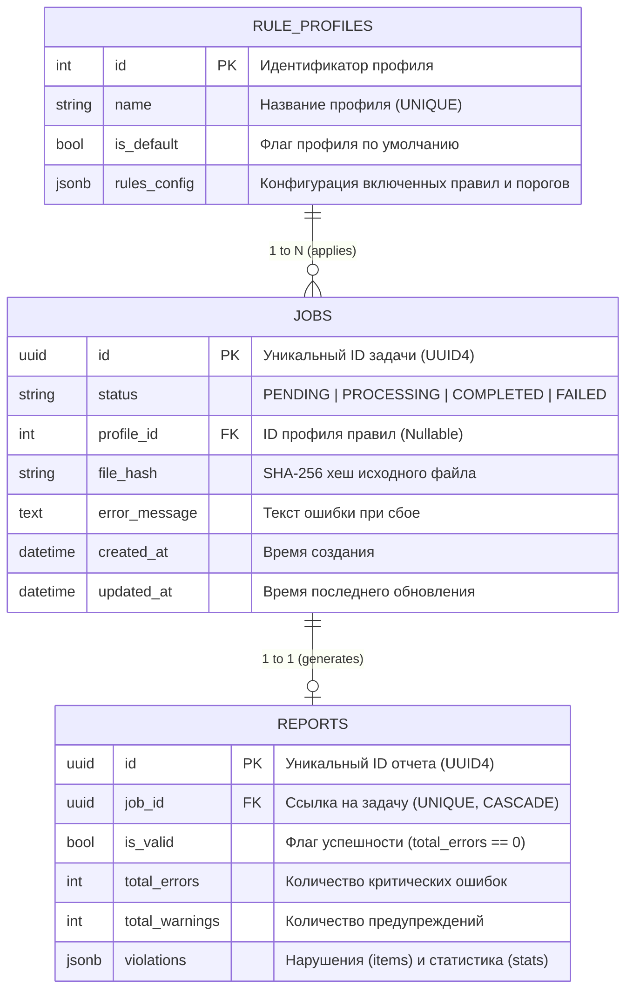
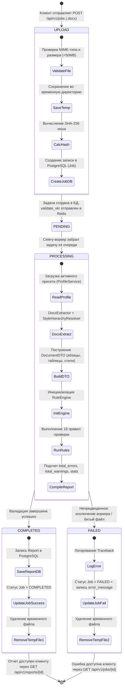
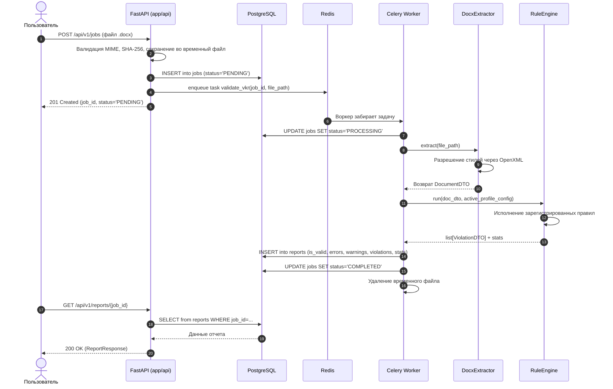

# Сервис автоматизированного нормоконтроля ВКР (Compliance Control FQW)

[](https://www.python.org/)
[](https://fastapi.tiangolo.com/)
[](https://docs.celeryq.dev/)
[](https://www.postgresql.org/)
[](https://docs.docker.com/compose/)
[]()

Production-ready сервис для автоматической проверки выпускных квалификационных работ (ВКР), курсовых и дипломных проектов на соответствие требованиям **ГОСТ 7.32-2017** и **Локальному регламенту нормоконтроля кафедры ИТ (2025 год)**.

---

## Оглавление
1. [Назначение и цели проекта](#1-назначение-и-цели-проекта)
2. [Архитектура системы](#2-архитектура-системы)
   - [Базовые инженерные принципы (KISS, DRY, YAGNI)](#базовые-инженерные-принципы-kiss-dry-yagni)
   - [Принципы SOLID в архитектуре](#принципы-solid-в-архитектуре)
   - [Паттерны проектирования (GoF и архитектурные)](#паттерны-проектирования-gof-и-архитектурные)
   - [Архитектурные антипаттерны и ловушки](#архитектурные-антипаттерны-и-ловушки)
   - [Компонентная схема (Mermaid)](#компонентная-схема)
   - [Схема данных (ERD-диаграмма)](#схема-данных-erd-диаграмма)
   - [Жизненный цикл задачи и документа (State Machine)](#жизненный-цикл-задачи-и-документа-state-machine)
   - [Сквозной поток данных (Sequence Diagram)](#сквозной-поток-данных)
3. [Структура репозитория](#3-структура-репозитория)
4. [Технологический стек](#4-технологический-стек)
5. [Слой адаптеров и экстракции (OpenXML / Docx)](#5-слой-адаптеров-и-экстракции-openxml--docx)
   - [StyleHierarchyResolver: разрешение иерархии стилей](#stylehierarchyresolver-разрешение-иерархии-стилей)
   - [DTO-модели документа](#dto-модели-документа)
6. [Движок правил (Rule Engine)](#6-движок-правил-rule-engine)
   - [Принцип работы и реестр](#принцип-работы-и-реестр)
   - [Каталог реализованных правил (16 модулей / 39 критериев)](#каталог-реализованных-правил)
   - [Изоляция сбоев (Crash Isolation)](#изоляция-сбоев-crash-isolation)
7. [Конфигурация и профили кафедры](#7-конфигурация-и-профили-кафедры)
8. [REST API и спецификация эндпоинтов](#8-rest-api-и-спецификация-эндпоинтов)
   - [Примеры запросов (cURL)](#примеры-запросов-curl)
9. [Асинхронная обработка (Celery & Redis)](#9-асинхронная-обработка-celery--redis)
10. [Локальный запуск и развертывание](#10-локальный-запуск-и-развертывание)
    - [Через Docker Compose (Рекомендуемый способ)](#1-быстрый-старт-через-docker-compose)
    - [Локальный запуск для разработки](#2-локальный-запуск-для-разработки-без-docker)
11. [Тестирование и контроль качества](#11-тестирование-и-контроль-качества)
    - [Запуск тестов](#запуск-тестов)
    - [Регламент актуализации и переписывания тестов](#регламент-актуализации-и-переписывания-тестов)
12. [Руководство для разработчиков: Как добавить новое правило](#12-руководство-для-разработчиков-как-добавить-новое-правило)
13. [Частые вопросы и Troubleshooting](#13-частые-вопросы-и-troubleshooting)

---

## 1. Назначение и цели проекта

Нормоконтроль — один из наиболее рутинных и трудоемких этапов проверки студенческих работ перед защитой. Ручная проверка 39 формальных критериев (поля, отступы первой строки, шрифты, заголовки, таблицы, рисунки, состав литературы, перекрестные ссылки, отсутствие попыток обхода антиплагиата) отнимает у преподавателей до 40 минут на один документ.

**Сервис решает следующие задачи:**
1. **Мгновенная детерминированная проверка:** Анализ документа за 2–5 секунд без субъективности проверяющего.
2. **Точная локализация замечаний:** Каждое нарушение содержит номер абзаца, физическую страницу (при наличии PDF), текстовый фрагмент (сниппет), фактическое и требуемое значения.
3. **Поддержка динамических настроек:** Кафедра может гибко изменять числовые пороги (например, минимальное число источников или отступ) через YAML-пресеты или веб-интерфейс без переписывания исходного кода.
4. **Защита от академического мошенничества:** Детекция скрытых подмен символов (латиница вместо кириллицы в русских словах).

---

## 2. Архитектура системы

### Базовые инженерные принципы (KISS, DRY, YAGNI)

#### 1. KISS (Keep It Simple, Stupid — «Не усложняй»)
* **Модульный монолит вместо микросервисов:** Весь бэкенд живет в единой кодовой базе (`app/`), собирается в один Docker-образ и масштабируется горизонтальным запуском нескольких копий Celery-воркеров. Исключены микросервисный оверинжиниринг, gRPC, service discovery и распределенные транзакции.
* **Отказ от ML/LLM на этапе MVP:** Проверка заголовков, отступов и цитат выполняется детерминированными алгоритмами и регулярными выражениями. Это обеспечивает 100% воспроизводимость результатов, скорость обработки в миллисекунды и нулевую стоимость инференса.
* **Gotenberg как готовый черный ящик:** Сервис не использует сложные C++ биндинги к LibreOffice на хосте, а отправляет один HTTP POST в изолированный headless-контейнер Gotenberg.

#### 2. DRY (Don't Repeat Yourself — «Не повторяйся»)
* **Единый экстрактор (`DocxExtractor`):** Документ OpenXML парсится **ровно один раз**. Экстрактор единожды вычисляет отступы, шрифты, таблицы и собирает `DocumentDTO`. Все 16 правил работают с готовым слепком данных без повторного открытия ZIP-архива `.docx`.
* **Переиспользуемые утилиты:** Нормализация пробелов, fuzzy-сравнение заголовков и разбор списков цитирования вынесены в модуль утилит ядра и переиспользуются правилами библиографии и структуры.
* **Configuration-Driven Presets:** Пороги проверок (отступ 12.5 мм, поля 30/15/20/20, 50 источников) не захардкожены в классах правил, а вынесены в YAML-конфигурации (`resources/rule_presets/`). Одно изменение в файле меняет поведение всей системы.

#### 3. YAGNI (You Aren't Gonna Need It — «Тебе это не понадобится»)
* **Отказ от устаревших форматов:** Поддерживается исключительно современный стандарт `.docx` (Office OpenXML), исключена избыточная поддержка устаревших бинарных форматов `.doc` и `.rtf`.
* **Лаконичная модель доступа:** Вместо тяжелой многоуровневой ролевой модели (RBAC) на этапе MVP студент загружает работу по открытому API, а преподаватель управляет профилями через дашборд.
* **Простая файловая система:** Отсутствует распределенное S3-хранилище; временные файлы хранятся локально в изолированной директории и удаляются сразу после завершения валидации.

---

### Принципы SOLID в архитектуре

Архитектура строго подчинена принципам Роберта Мартина (Clean Architecture):

| Принцип SOLID | Где и как реализован в проекте | Чем грозит нарушение |
| :--- | :--- | :--- |
| **S (Single Responsibility)** | Каждый класс решает ровно одну задачу:<br>• `DocxExtractor` — только читает XML и строит DTO (не знает правил ГОСТа).<br>• `StyleHierarchyResolver` — только разрешает наследование стилей OpenXML.<br>• `ParagraphIndentRule` — только проверяет дельту отступа (не знает, откуда взялся параграф).<br>• `jobs.py` — только принимает HTTP-запросы и отдает JSON. | Если засунуть проверку отступов прямо в экстрактор, при изменении ГОСТа придется переписывать парсер Word. |
| **O (Open/Closed)** | **Движок правил (`RuleEngine`) закрыт для модификации, но открыт для расширения.**<br>Чтобы добавить новое правило кафедры, код `engine.py` не модифицируется: достаточно создать файл в `rules/` и повесить декоратор `@register_rule("RULE_ID")`. | Без этого `engine.py` превратился бы в простыню из тысяч строк с бесконечными ветвлениями `if rule_name == '...'`. |
| **L (Liskov Substitution)** | Все правила наследуют абстрактный класс `BaseRule` и реализуют контракт:<br>`check(doc: DocumentDTO, params: dict) -> list[ViolationDTO]`.<br>Для движка правил не имеет значения, какое именно правило выполняется: проверка полей или антиплагиат — все они полностью взаимозаменяемы. | Если одно правило вернет строку вместо списка DTO или потребует другие аргументы, конвейер упадет во время выполнения. |
| **I (Interface Segregation)** | Разделение DTO и схем API:<br>• `ParagraphDTO` содержит только распарсенные данные документа.<br>• `ViolationDTO` содержит только данные найденного дефекта.<br>• `ReportResponse` в `schemas/report.py` отдает клиенту только то, что нужно фронтенду. | Клиент API не должен зависеть от внутренних технических полей парсера. |
| **D (Dependency Inversion)** | **Ядро бизнес-логики не зависит от библиотек парсинга.**<br>Правила в `rule_engine/rules/` зависят от абстрактных структур `DocumentDTO`, а не от объектов `docx.text.paragraph.Paragraph`. При замене `python-docx` на другую библиотеку правила проверки останутся неизменными. | Прямой импорт библиотек парсинга в правила проверки намертво свяжет бизнес-логику с конкретной библиотекой. |

---

### Паттерны проектирования (GoF и архитектурные)

В проекте задействовано 7 фундаментальных паттернов:

1. **Strategy (Стратегия) — Поведенческий паттерн:**  
   *Где:* Вся папка `app/rule_engine/rules/`.  
   *Суть:* Каждое правило ГОСТа — это отдельная стратегия валидации (`MarginsRule`, `TablesRule`, `HomoglyphsRule`), реализующая общий интерфейс `BaseRule`. Позволяет изолированно тестировать каждое правило модульными тестами (unit-тестами) без базы данных и сети.
2. **Plugin / Registry (Реестр) — Архитектурный паттерн:**  
   *Где:* `app/rule_engine/registry.py`.  
   *Суть:* Реестр `RULE_REGISTRY = {}` и декоратор `@register_rule(id)`. При старте приложения классы правил регистрируют себя автоматически. Диспетчер берет имя правила из YAML-конфигурации и динамически инстанцирует нужный класс по ключу.
3. **Data Transfer Object (DTO) — Корпоративный паттерн:**  
   *Где:* `app/domain/dto/`.  
   *Суть:* Иммутабельные классы `DocumentDTO`, `ParagraphDTO`, `TableDTO`, `LocationDTO`. Очищают документ Word от внутреннего шума OpenXML (закладки, ревизии, RSID-метки авторов, секции слияния) и передают правилам чистые числовые и строковые данные.
4. **Adapter (Адаптер) & Facade (Фасад) — Структурные паттерны:**  
   *Где:* `app/adapters/extractors/` и `app/adapters/converters/gotenberg.py`.  
   *Адаптер:* `DocxExtractor` адаптирует проприетарную XML-модель Microsoft OpenXML к доменной модели `DocumentDTO`.  
   *Фасад:* `GotenbergClient` скрывает за методом `convert_to_pdf()` детали сетевого взаимодействия: создание multipart-форм, передачу потоков байт и обработку HTTP-ошибок.
5. **Resource Acquisition Is Initialization (RAII) / Context Manager:**  
   *Где:* `app/adapters/storage/local.py` (`TempFileManager`) и `app/worker/tasks.py`.  
   *Суть:* Гарантированное освобождение ресурсов через контекстные менеджеры и блок `finally:`. Временный файл на диске удаляется всегда, даже при падении воркера или фатальном исключении.
6. **Producer-Consumer (Поставщик-Потребитель):**  
   *Где:* Связка `FastAPI` -> `Redis` -> `Celery Worker`.  
   *Суть:* Веб-сервер принимает файл, регистрирует задачу в Redis и моментально отдает ответ клиенту. Celery-воркеры разбирают задачи из очереди по мере освобождения ресурсов CPU, защищая систему от деградации при пиковых нагрузках.
7. **Graceful Degradation (Плавная деградация) / Fault Tolerance:**  
   *Где:* `app/services/validation_pipeline.py` и `app/rule_engine/engine.py`.  
   *Суть:* Сбои в отдельных правилах изолируются (Crash Isolation): если одно правило аварийно завершается, конвейер логирует ошибку, регистрирует предупреждение и успешно выполняет остальные 15 правил, не обрывая процесс 500-й ошибкой.

---

### Архитектурные антипаттерны и ловушки

Команда разработки обязана соблюдать следующие ограничения:
1. **Запрет Leaky Abstractions (Утечка абстракций):** Внутри файлов правил (`app/rule_engine/rules/`) запрещен прямой импорт `docx` или `lxml`. Правило должно оперировать исключительно DTO-моделями.
2. **Запрет God Rule (Правило-бог):** Запрещено объединять разнородные проверки в один монолитный класс (например, объединять поля, шрифты и заголовки в один валидатор). Каждое правило проверяет один атомарный аспект документа.
3. **Запрет смешивания DTO и ORM-моделей:** Модели базы данных SQLAlchemy (`Job`, `Report`) не должны проникать в слой экстракции или движок правил.

---

### Компонентная схема

```mermaid
flowchart TD
    Client["Клиент (Web UI / Swagger)"] -->|POST /jobs| API["FastAPI Application"]
    Client -->|GET /reports/{id}| API

    subgraph Infrastructure ["Инфраструктура"]
        Redis[("Redis 7 (Broker & Result Backend)")]
        Postgres[("PostgreSQL 16 (Jobs & Reports)")]
        Gotenberg["Gotenberg (PDF Engine)"]
    end

    API -->|Создание Job| Postgres
    API -->|validate_vkr.delay| Redis

    Worker["Celery Worker"] -->|Берет задачу| Redis
    Worker -->|Чтение статуса| Postgres

    subgraph Core Pipeline ["Конвейер валидации"]
        Worker --> VP["ValidationPipeline"]
        VP --> Extractor["DocxExtractor"]
        Extractor --> Resolver["StyleHierarchyResolver"]
        Resolver --> DTO["DocumentDTO"]
        VP --> Engine["RuleEngine"]
        Engine --> Registry["RULE_REGISTRY (16 Rules)"]
        Registry --> Violations["list[ViolationDTO]"]
    end

    VP -->|Report & Stats| Worker
    Worker -->|Запись отчета и статус COMPLETED| Postgres
```

### Схема данных (ERD-диаграмма)

Структура реляционной базы данных спроектирована с учетом максимальной гибкости для хранения разнородных нарушений нормоконтроля с использованием типа `JSONB`:



#### Структура поля `violations` (JSONB) в таблице `reports`:
```json
{
  "items": [
    {
      "rule_id": "HEADINGS_FORMAT",
      "severity": "ERROR",
      "message": "Заголовок 1 уровня должен быть без абзацного отступа. Обнаружен отступ 12.5 мм.",
      "location": {
        "page_number": null,
        "paragraph_index": 0,
        "item_title": null,
        "snippet": "ВВЕДЕНИЕ"
      },
      "actual_value": "12.5 мм",
      "expected_value": "0.0 мм"
    }
  ],
  "stats": {
    "total_paragraphs": 223,
    "total_tables": 6,
    "total_sections": 1
  }
}
```

### Жизненный цикл задачи и документа (State Machine)



### Сквозной поток данных



---

## 3. Структура репозитория

```text
PW_2026_complianceControlFQW/
├── alembic/                         # Миграции базы данных (Alembic)
│   ├── versions/                    # Версии схемы БД
│   └── env.py                       # Асинхронное окружение Alembic
├── app/                             # Основной исходный код бэкенда
│   ├── adapters/                    # Слой ввода-вывода (Адаптеры)
│   │   ├── converters/              # Gotenberg клиент для конвертации DOCX -> PDF
│   │   ├── extractors/              # Извлечение данных из документов
│   │   │   └── docx/
│   │   │       ├── document_parser.py # Главный экстрактор DocxExtractor
│   │   │       └── styles_xml.py    # Резолвер стилей и наследования OpenXML
│   │   └── storage/                 # Файловые хранилища (TempFileManager)
│   ├── api/                         # Слой REST API (FastAPI)
│   │   ├── dependencies.py          # Внедрение зависимостей (get_db и др.)
│   │   ├── routes/                  # Маршрутизаторы
│   │   │   ├── v1/
│   │   │   │   ├── jobs.py          # POST /jobs, GET /jobs/{id}
│   │   │   │   └── reports.py       # GET /reports/{id}
│   │   │   └── router.py            # Корневой маршрутизатор API v1
│   │   └── schemas/                 # Pydantic-контракты запросов и ответов
│   │       ├── job.py               # JobCreateResponse, JobStatusResponse
│   │       ├── profile.py           # Схемы профилей правил
│   │       └── report.py            # ReportResponse, ViolationSchema, DocumentStatsSchema
│   ├── core/                        # Ядро приложения и инфраструктура
│   │   ├── config.py                # Pydantic Settings (ENV переменные)
│   │   └── database.py              # Инициализация SQLAlchemy (AsyncEngine, sessionmaker)
│   ├── domain/                      # Доменный слой (Чистая бизнес-модель)
│   │   ├── dictionaries/            # Словари англицизмов и таблицы омоглифов
│   │   ├── dto/                     # Data Transfer Objects
│   │   │   ├── document.py          # DocumentDTO, ParagraphDTO, TableDTO
│   │   │   └── violation.py         # ViolationDTO, LocationDTO
│   │   └── models/                  # SQLAlchemy ORM сущности
│   │       ├── job.py               # Модель Job (задачи)
│   │       ├── profile.py           # Модель RuleProfile (профили кафедры)
│   │       └── report.py            # Модель Report (отчеты валидации)
│   ├── rule_engine/                 # Движок правил валидации нормоконтроля
│   │   ├── base.py                  # Базовый класс BaseRule
│   │   ├── registry.py              # Реестр правил RULE_REGISTRY и декоратор @register_rule
│   │   ├── engine.py                # Диспетчер исполнения RuleEngine
│   │   └── rules/                   # Модули проверок по категориям
│   │       ├── typography/          # Отступы, поля, шрифты, заголовки
│   │       ├── structure/           # Обязательные разделы, главы, оглавление
│   │       ├── objects/             # Рисунки, таблицы, листинги, приложения
│   │       ├── bibliography/        # Источники, ГОСТ цитирования, перекрестные ссылки
│   │       └── text_quality/        # Омоглифы (антиплагиат), англицизмы, списки
│   ├── services/                    # Сервисный слой приложения
│   │   ├── job_service.py           # Бизнес-логика создания задач
│   │   ├── profile_service.py       # Загрузка и кэширование профилей правил
│   │   └── validation_pipeline.py   # Конвейер оркестрации парсинга и проверок
│   ├── worker/                      # Celery-воркер
│   │   ├── tasks.py                 # Асинхронная задача validate_vkr
│   │   └── scheduled.py             # Фоновая очистка временных файлов
│   └── main.py                      # Входная точка запуска FastAPI приложения
├── context/                         # Нормативная документация и архитектурные гайды
│   ├── 2025_Kriterii_normokontrolya_pdf.pdf # 39 критериев кафедры ИТ от 2025 года
│   ├── gost_7.32-2017.pdf           # ГОСТ 7.32-2017
│   ├── architecture.md              # Архитектурный манифест
│   └── handoff.md                   # Руководство по передаче проекта
├── resources/                       # Статические конфигурации и пресеты
│   └── rule_presets/                # YAML-конфигурации кафедр
│       ├── department_vkr_2025.yaml # Дефолтный пресет кафедры ИТ 2025
│       └── gost_7_32_2017.yaml      # Базовый профиль ГОСТ 7.32-2017
├── tests/                           # Автотесты (Pytest)
│   ├── integration/                 # Сквозные тесты пайплайна и HTTP API
│   └── unit/                        # Модульные тесты экстрактора и каждого правила
├── docker-compose.yml               # Оркестрация контейнеров сервиса
├── Dockerfile                       # Многоэтапная сборка Docker-образа
├── pyproject.toml                   # Конфигурация зависимостей и инструментов
└── requirements.txt                 # Зафиксированные зависимости Python
```

---

## 4. Технологический стек

| Компонент | Технология | Обоснование выбора |
| :--- | :--- | :--- |
| **Язык разработки** | Python 3.13 | Современный синтаксис, строгая типизация (`typing`, `dataclasses`), высокая производительность. |
| **Web-фреймворк** | FastAPI | Асинхронность, высокая скорость, автоматическая генерация документации OpenAPI / Swagger. |
| **Очередь задач** | Celery + Redis | Надежная асинхронная обработка тяжелых задач парсинга документов, изоляция нагрузки от HTTP-сервера. |
| **База данных** | PostgreSQL 16 | Хранение статусов задач и результатов проверок в виде JSONB для гибкости структуры нарушений. |
| **ORM & Миграции** | SQLAlchemy 2.0 (asyncio) + Alembic | Асинхронный доступ к базе (`asyncpg`), строгая декларативная типизация `Mapped[]`. |
| **Парсинг документов** | `python-docx` + `lxml` | Низкоуровневый разбор OpenXML-дерева, таблиц стилей `styles.xml` и прямого форматирования. |
| **Конвертация PDF** | Gotenberg | Надежная конвертация DOCX в PDF через headless LibreOffice для точной пагинации. |
| **Валидация данных** | Pydantic v2 | Сверхбыстрая валидация входных данных и сериализация JSON-ответов. |
| **Тестирование** | Pytest + AnyIO + Faker | Полное покрытие всех правил позитивными, негативными и граничными сценариями. |

---

## 5. Слой адаптеров и экстракции (OpenXML / Docx)

Парсинг документов `.docx` — одна из наиболее сложных инженерных задач в проекте, поскольку спецификация Microsoft Office OpenXML (OOXML) допускает многоуровневое переопределение параметров форматирования.

### StyleHierarchyResolver: разрешение иерархии стилей
В Microsoft Word свойства текста (шрифт, размер, отступ, выравнивание) могут задаваться на четырех разных уровнях:
1. Прямое форматирование абзаца (`<w:pPr>` внутри `document.xml`).
2. Прямой стиль абзаца (например, пользовательский стиль «Дефолт»).
3. Родительский стиль (стиль «Обычный», на котором базируется «Дефолт» через `<w:basedOn>`).
4. Дефолтные настройки документа (`<w:docDefaults>`).

Если в файле Word пользователь применил стиль, где отступ первой строки равен `1.25 см`, стандартная библиотека `python-docx` через `paragraph.paragraph_format.first_line_indent` возвращает `None`, если свойство не переопределено локально в конкретном абзаце.

Для решения этой проблемы разработан [`StyleHierarchyResolver`](file:///c:/Users/Dimon/Desktop/Солянка/Учеба/3курс/пд/проект/PW_2026_complianceControlFQW/app/adapters/extractors/docx/styles_xml.py):
* Читает и строит граф стилей документа из `word/styles.xml`.
* Рекурсивно поднимается по цепочке `w:basedOn`, кэшируя разрешенные свойства с защитой от циклических ссылок (`visited set`).
* Точно вычисляет эффективные значения:
  - `resolve_first_line_indent_mm()`: отступ первой строки (в миллиметрах).
  - `resolve_alignment()`: выравнивание (`LEFT`, `CENTER`, `RIGHT`, `JUSTIFY`).
  - `resolve_font_name()` и `resolve_font_size_pt()`: гарнитура и кегль.
* Детектирует встроенные изображения (`w:drawing`, `w:pict`), помечая флаг `has_image = True` в DTO абзаца.

### DTO-модели документа
Экстрактор [`DocxExtractor`](file:///c:/Users/Dimon/Desktop/Солянка/Учеба/3курс/пд/проект/PW_2026_complianceControlFQW/app/adapters/extractors/docx/document_parser.py) преобразует файл в иммутабельные доменные объекты:
* [`DocumentDTO`](file:///c:/Users/Dimon/Desktop/Солянка/Учеба/3курс/пд/проект/PW_2026_complianceControlFQW/app/domain/dto/document.py): размеры полей (в мм), ориентация страницы, списки абзацев и таблиц.
* [`ParagraphDTO`](file:///c:/Users/Dimon/Desktop/Солянка/Учеба/3курс/пд/проект/PW_2026_complianceControlFQW/app/domain/dto/document.py): сырой текст, очищенный текст, имя стиля, уровень заголовка, выравнивание, размер шрифта, отступ первой строки (мм), межстрочный интервал, флаг заголовка, флаг наличия картинок (`has_image`).
* [`TableDTO`](file:///c:/Users/Dimon/Desktop/Солянка/Учеба/3курс/пд/проект/PW_2026_complianceControlFQW/app/domain/dto/document.py): сетка ячеек, количество строк и столбцов.

---

## 6. Движок правил (Rule Engine)

### Принцип работы и реестр
Архитектура движка построена по паттерну **Strategy + Registry**:

1. Все правила наследуются от единого абстрактного базового класса [`BaseRule`](file:///c:/Users/Dimon/Desktop/Солянка/Учеба/3курс/пд/проект/PW_2026_complianceControlFQW/app/rule_engine/base.py):
   ```python
   class BaseRule(ABC):
       rule_id: str
       category: str
       description: str
       default_severity: str = "ERROR"

       @abstractmethod
       def check(self, doc: DocumentDTO, params: dict) -> list[ViolationDTO]:
           pass
   ```
2. Декоратор `@register_rule("RULE_ID")` автоматически регистрирует класс в глобальном словаре `RULE_REGISTRY`.
3. При старте валидации [`RuleEngine`](file:///c:/Users/Dimon/Desktop/Солянка/Учеба/3курс/пд/проект/PW_2026_complianceControlFQW/app/rule_engine/engine.py) принимает конфигурацию активного профиля, инстанцирует только включенные (`enabled: true`) правила и передает им параметры (например, ожидаемый размер шрифта или отступ).

### Каталог реализованных правил

| Rule ID | Категория | Что проверяет | Соответствие |
| :--- | :--- | :--- | :--- |
| `PAGE_MARGINS` | Типографика | Поля страницы: левое 30 мм, правое 15 мм, верхнее 20 мм, нижнее 20 мм (допуск ±1 мм). | ГОСТ 7.32 (п. 5.1.2) / Кафедра (п. 24) |
| `PARAGRAPH_INDENT` | Типографика | Отступ первой строки основного текста: 12.5 мм (допуск ±1 мм). Автоматически пропускает подписи к рисункам, таблицам и строки с картинками. | ГОСТ 7.32 (п. 5.1.2) / Кафедра (п. 25) |
| `MAIN_TEXT_FONT` | Типографика | Гарнитура (Times New Roman) и кегль (14 pt) основного текста. | ГОСТ 7.32 (п. 5.1.2) / Кафедра (п. 25) |
| `HEADINGS_FORMAT` | Типографика | Заголовки 1 уровня: ПРОПИСНЫЕ, по центру, БЕЗ отступа. Заголовки 2 уровня: с отступом 1.25 см. Запрет точек на конце. | ГОСТ 7.32 (п. 5.2) / Кафедра (п. 32-34) |
| `REQUIRED_SECTIONS` | Структура | Обязательное наличие структурных элементов: АННОТАЦИЯ, ВВЕДЕНИЕ, ЗАКЛЮЧЕНИЕ, СПИСОК ИСТОЧНИКОВ. | ГОСТ 7.32 (п. 5.1) / Кафедра (п. 8, 12, 14, 15) |
| `CHAPTERS_COUNT` | Структура | Наличие не менее 3 глав/разделов основной части, а также наличие выводов в конце каждого раздела. | Кафедра (п. 13, 29) |
| `TOC_MATCHING` | Структура | Наличие раздела «СОДЕРЖАНИЕ». Нечеткая сверка (Fuzzy Match) заголовков в оглавлении с фактическими заголовками в тексте. | ГОСТ 7.32 (п. 5.1.3) / Кафедра (п. 9-11) |
| `FIGURES_FORMAT` | Объекты | Формат подписи `Рисунок X – Название`, строго по центру, без точки на конце. Проверка положения: подпись должна быть **строго ПОД рисунком**. Проверка наличия ссылки на рисунок в тексте. | ГОСТ 7.32 (п. 5.3.2) / Кафедра (п. 20, 22) |
| `TABLES_FORMAT` | Объекты | Формат `Таблица X – Название`, выравнивание влево, без абзацного отступа. Проверка наличия ссылок на таблицы в тексте. | ГОСТ 7.32 (п. 5.3.3) / Кафедра (п. 20, 21) |
| `LISTINGS_FORMAT` | Объекты | Оформление программного кода и листингов: подпись, моноширинный шрифт, недопустимость вставки кода скриншотом. | Кафедра (п. 19, 23) |
| `APPENDICES_FORMAT` | Объекты | Оформление приложений: `ПРИЛОЖЕНИЕ А`, допустимые буквы русского алфавита (исключая Ё, З, Й, О, Ч, Ь, Ъ, Ы). | ГОСТ 7.32 (п. 5.7) / Кафедра (п. 19) |
| `SOURCES_COUNT` | Библиография | Объем библиографии: не менее 50 источников (для ВКР), доля иностранных источников >= 5%, электронных <= 50%, наличие дат обращения. Поддержка автонумерованных списков Word. | Кафедра (п. 15-17) |
| `CROSS_REFERENCES` | Библиография | Проверка ссылок в тексте на каждый источник библиографии (форматы `[7]`, `[7-9]`, `[7, c. 23]`). Отсутствие неиспользованных источников. | ГОСТ 7.32 (п. 5.6) / Кафедра (п. 18) |
| `LISTS_FORMAT` | Текст | Оформление списков (маркированные и нумерованные): точка с запятой в конце элементов, строчная буква в начале, точка в конце списка. | ГОСТ 7.32 (п. 5.1.4) / Кафедра (п. 28) |
| `ANTI_PLAGIARISM_HOMOGLYPHS` | Текст | Детекция скрытых замен кириллицы на латиницу в словах. Умное разделение составных IT-терминов (`IP-адрес`, `HTTP-сервер`, `DNS-сервер`). | Кафедра (п. 26) |
| `FORBIDDEN_ANGLICISMS` | Текст | Поиск запрещенных жаргонизмов и англицизмов, имеющих утвержденные русскоязычные аналоги (например, «бэкенд» -> «серверная часть»). | Кафедра (п. 7) |

### Изоляция сбоев (Crash Isolation)
Одно из ключевых архитектурных требований — **Fault Tolerance**. Если в одном из правил возникает непредвиденное исключение (например, специфический Unicode-символ в формуле ломает регулярное выражение), движок правил перехватывает ошибку, логирует Traceback и продолжает выполнение всех остальных правил. В итоговый отчет добавляется нарушение с критичностью `WARNING`, а сам конвейер не падает.

---

## 7. Конфигурация и профили кафедры

Конфигурации правил хранятся в формате YAML в каталоге `resources/rule_presets/`:
* `department_vkr_2025.yaml`: Официальные требования кафедры ИТ 2025 года.
* `gost_7_32_2017.yaml`: Базовый ГОСТ 7.32-2017.

### Пример конфигурационного файла (`department_vkr_2025.yaml`):
```yaml
profile_name: "Кафедра ИТ — Нормоконтроль 2025"
rules:
  PARAGRAPH_INDENT:
    enabled: true
    expected_mm: 12.5
    tolerance_mm: 1.0
  PAGE_MARGINS:
    enabled: true
    left_mm: 30.0
    right_mm: 15.0
    top_mm: 20.0
    bottom_mm: 20.0
  MAIN_TEXT_FONT:
    enabled: true
    expected_font_name: "Times New Roman"
    expected_size_pt: 14.0
  HEADINGS_FORMAT:
    enabled: true
  REQUIRED_SECTIONS:
    enabled: true
  CHAPTERS_COUNT:
    enabled: true
    min_chapters: 3
  TOC_MATCHING:
    enabled: true
  FIGURES_FORMAT:
    enabled: true
  TABLES_FORMAT:
    enabled: true
  LISTINGS_FORMAT:
    enabled: true
  APPENDICES_FORMAT:
    enabled: true
  SOURCES_COUNT:
    enabled: true
    min_count: 50
    min_foreign_percent: 5.0
    max_electronic_percent: 50.0
  CROSS_REFERENCES:
    enabled: true
  LISTS_FORMAT:
    enabled: true
  ANTI_PLAGIARISM_HOMOGLYPHS:
    enabled: true
  FORBIDDEN_ANGLICISMS:
    enabled: true
```

Сервис [`ProfileService`](file:///c:/Users/Dimon/Desktop/Солянка/Учеба/3курс/пд/проект/PW_2026_complianceControlFQW/app/services/profile_service.py) проверяет наличие переопределений в БД (таблица `rule_profiles`). Если `profile_id` не передан, прозрачно загружается дефолтный файл кафедры.

---

## 8. REST API и спецификация эндпоинтов

Сервис предоставляет лаконичный асинхронный REST API. Интерактивная документация Swagger UI доступна по адресу `http://localhost:8000/docs`.

### Основные эндпоинты

| Метод | URL | Описание | Возвращаемые коды |
| :--- | :--- | :--- | :--- |
| `POST` | `/api/v1/jobs` | Загрузка файла `.docx` для проверки | `201 Created`, `400 Bad Request` |
| `GET` | `/api/v1/jobs/{job_id}` | Проверка статуса выполнения задачи | `200 OK`, `404 Not Found` |
| `GET` | `/api/v1/reports/{job_id}` | Получение готового отчета с замечаниями | `200 OK`, `202 Accepted`, `404 Not Found` |

### Примеры запросов (cURL)

#### 1. Загрузка документа на проверку:
```bash
curl -X POST "http://localhost:8000/api/v1/jobs" \
  -H "accept: application/json" \
  -H "Content-Type: multipart/form-data" \
  -F "file=@VKR_Final_Ivanov.docx"
```

**Ответ (201 Created):**
```json
{
  "job_id": "8a1badd2-fe0c-4659-acd2-613d325f736d",
  "status": "PENDING"
}
```

#### 2. Проверка статуса:
```bash
curl -X GET "http://localhost:8000/api/v1/jobs/8a1badd2-fe0c-4659-acd2-613d325f736d"
```

**Ответ (200 OK):**
```json
{
  "job_id": "8a1badd2-fe0c-4659-acd2-613d325f736d",
  "status": "COMPLETED",
  "error_message": null
}
```

#### 3. Получение итогового отчета:
```bash
curl -X GET "http://localhost:8000/api/v1/reports/8a1badd2-fe0c-4659-acd2-613d325f736d"
```

**Ответ (200 OK):**
```json
{
  "job_id": "8a1badd2-fe0c-4659-acd2-613d325f736d",
  "filename": "document.docx",
  "is_valid": false,
  "summary": "Обнаружено нарушений: 2 критических ошибок, 1 предупреждений.",
  "total_errors": 2,
  "total_warnings": 1,
  "stats": {
    "total_paragraphs": 223,
    "total_tables": 6,
    "total_sections": 1
  },
  "violations": [
    {
      "rule_id": "HEADINGS_FORMAT",
      "severity": "ERROR",
      "message": "Заголовок 1 уровня должен быть без абзацного отступа. Обнаружен отступ 12.5 мм.",
      "location": {
        "page_number": null,
        "paragraph_index": 0,
        "item_title": null,
        "snippet": "ВВЕДЕНИЕ"
      },
      "actual_value": "12.5 мм",
      "expected_value": "0.0 мм"
    },
    {
      "rule_id": "FIGURES_FORMAT",
      "severity": "ERROR",
      "message": "Подпись рисунка '9' должна быть выровнена по центру. Обнаружено выравнивание: JUSTIFY.",
      "location": {
        "page_number": null,
        "paragraph_index": 142,
        "item_title": null,
        "snippet": "Рисунок 9 - Настройка OSPF на R3."
      },
      "actual_value": "JUSTIFY",
      "expected_value": "CENTER"
    },
    {
      "rule_id": "FIGURES_FORMAT",
      "severity": "WARNING",
      "message": "В конце подписи рисунка '9' точка не ставится.",
      "location": {
        "page_number": null,
        "paragraph_index": 142,
        "item_title": null,
        "snippet": "Рисунок 9 - Настройка OSPF на R3."
      },
      "actual_value": "R3.",
      "expected_value": "Без точки"
    }
  ]
}
```

---

## 9. Асинхронная обработка (Celery & Redis)

1. **Неблокирующий HTTP-поток:** Прием файла и его предварительная валидация занимают менее 50 миллисекунд.
2. **Задача `validate_vkr`:**
   - Выполняется воркером в изолированном процессе.
   - Изменяет статус задачи `Job` в БД на `PROCESSING`.
   - Запускает `ValidationPipeline`.
   - Создает запись `Report` с полным списком замечаний и статистикой.
   - Гарантированно удаляет временный файл в блоке `finally`.
   - При фатальной ошибке переводит задачу в статус `FAILED`, сохраняя текст исключения в `error_message`.
3. **Периодическая очистка (`scheduled.py`):** Celery Beat периодически вызывает очистку забытых файлов старше 24 часов из временной директории.

---

## 10. Локальный запуск и развертывание

### 1. Быстрый старт через Docker Compose

Для промышленной или демонстрационной эксплуатации используется готовый стек контейнеров:

```bash
# 1. Клонируйте репозиторий
git clone https://github.com/your-username/PW_2026_complianceControlFQW.git
cd PW_2026_complianceControlFQW

# 2. Создайте файл переменных окружения из примера (при необходимости)
# По умолчанию docker-compose.yml уже содержит базовые настройки для локального запуска

# 3. Соберите и запустите все контейнеры
docker compose up -d --build
```

**Сервисы в составе Docker Compose:**
* `api`: HTTP-сервер FastAPI на порту `8000` (автоперезагрузка кода через volume mount).
* `worker`: Celery-воркер, обрабатывающий задачи валидации.
* `db`: PostgreSQL 16 на порту `5432`.
* `redis`: Redis 7 на порту `6379`.
* `gotenberg`: Конвертер LibreOffice/Chromium на порту `3000`.

Проверка статуса контейнеров:
```bash
docker compose ps
```

Просмотр логов воркера:
```bash
docker compose logs -f worker
```

Перезапуск воркера и API после правки правил:
```bash
docker compose restart api worker
```

---

### 2. Локальный запуск для разработки (без Docker)

Если вы разрабатываете правила или работаете с кодом напрямую на хост-машине (Windows/macOS/Linux):

#### Требования:
* Python 3.13+
* Установленный PostgreSQL и Redis (можно запустить только их через `docker compose up -d db redis`)

#### Шаги:
```bash
# 1. Создание и активация виртуального окружения
python -m venv .venv

# Windows:
.venv\Scripts\activate
# Linux / macOS:
source .venv/bin/activate

# 2. Установка зависимостей
pip install --upgrade pip
pip install -r requirements.txt

# 3. Применение миграций БД
alembic upgrade head

# 4. Запуск FastAPI (Терминал 1)
uvicorn app.main:app --host 0.0.0.0 --port 8000 --reload

# 5. Запуск Celery Worker (Терминал 2)
# Для Windows:
celery -A app.worker.tasks.celery_app worker --loglevel=info -P solo
# Для Linux/macOS:
celery -A app.worker.tasks.celery_app worker --loglevel=info
```

Документация API откроется по адресу: `http://localhost:8000/docs`.

---

## 11. Тестирование и контроль качества

### Запуск тестов
Проект полностью покрыт автоматическими тестами. Для тестирования используется фреймворк `pytest`.

```bash
# Запуск полного набора тестов
pytest

# Запуск с подробным выводом
pytest -v

# Запуск только интеграционных тестов
pytest tests/integration/

# Запуск конкретной группы правил (например, типографика)
pytest tests/unit/test_typography_rules.py
```

Текущий статус тест-сьюта:
* **110 тестов пройдено успешно (0 failures)**.
* Покрыты модульные тесты каждого из 16 правил, извлечение стилей из OpenXML и сквозной интеграционный сценарий.

---

### Регламент актуализации и переписывания тестов

> [!IMPORTANT]
> **Тесты — это живая спецификация нормоконтроля.**  
> При изменении внешних регламентов, модификации доменных структур DTO или уточнении формулировок правил **тесты ОБЯЗАТЕЛЬНО должны быть актуализированы или переписаны**. Падение тестов после изменения бизнес-логики — нормальный процесс TDD, требующий осознанного обновления проверок.

#### 1. В каких случаях тесты необходимо переписать или дополнить:

1. **Изменение требований ГОСТ или кафедры:**
   - *Пример:* Кафедра снизила порог источников с 50 до 40 или разрешила отступ 10 мм вместо 12.5 мм.
   - *Действие:* В файле `tests/unit/test_bibliography_rules.py` и `test_rule_engine.py` необходимо обновить ассерты ожидаемых значений `expected_value` и пороги срабатывания.
2. **Расширение доменных моделей DTO:**
   - *Пример:* Добавление в `ParagraphDTO` флага `has_image: bool = False` или новых параметров таблицы.
   - *Действие:* Если сигнатура конструктора или дефолтные поля DTO меняются, фикстуры документов в unit-тестах должны быть обновлены.
3. **Устранение ложных срабатываний (False Positives):**
   - *Пример:* Ранее слово `IP-адрес` вызывало ошибку антиплагиата. После добавления исключения для составных IT-терминов старый тест, ожидавший ошибку на любом смешении латиницы и кириллицы, стал невалидным.
   - *Действие:* Тест переписывается: легитимные термины теперь проверяются на `len(violations) == 0`, а попытки скрытого обмана (например, `cервер` с английской `c`) выделяются в отдельный тест.
4. **Изменение контрактов API или Pydantic-схем:**
   - *Пример:* Добавление новых полей в `ReportResponse` или `DocumentStatsSchema`.
   - *Действие:* В `tests/integration/test_full_pipeline.py` обновляется валидация выходных структур отчета.

#### 2. Правила разработки тестов для команды:
* **Принцип изоляции (Unit):** Модульные тесты правил (`tests/unit/test_*_rules.py`) **никогда не должны обращаться к реальной базе данных или файловой системе**. Они создают фиктивный `DocumentDTO` в памяти и передают его методу `rule.check(doc, params)`.
* **Принцип TDD (Test-Driven Development):** При обнаружении бага или добавлении нового правила сначала пишется падающий тест, воспроизводящий дефект (Red), затем пишется исправление в коде правила (Green), после чего проводится рефакторинг (Refactor).
* **Контроль регрессии:** Ни один коммит не должен попадать в ветку `master` без прохождения команды `pytest` с кодом возврата `0`.

---

## 12. Руководство для разработчиков: Как добавить новое правило

Благодаря открытой архитектуре добавление новой проверки занимает **менее 15 минут** и не требует правок существующих классов.

### Шаг 1. Создайте файл правила
Создайте файл в соответствующей подпапке `app/rule_engine/rules/` (например, `app/rule_engine/rules/typography/line_spacing.py`):

```python
from app.domain.dto.document import DocumentDTO
from app.domain.dto.violation import LocationDTO, ViolationDTO
from app.rule_engine.base import BaseRule
from app.rule_engine.registry import register_rule


@register_rule("LINE_SPACING")
class LineSpacingRule(BaseRule):
    """Проверяет полуторный межстрочный интервал (1.5 строки)."""

    def check(self, doc: DocumentDTO, params: dict) -> list[ViolationDTO]:
        expected_spacing = float(params.get("expected_spacing", 1.5))
        violations: list[ViolationDTO] = []

        for i, p in enumerate(doc.paragraphs):
            if not p.text.strip() or p.is_heading:
                continue

            # Допустим, интервал отличается от ожидаемого
            if p.line_spacing is not None and abs(p.line_spacing - expected_spacing) > 0.1:
                violations.append(
                    ViolationDTO(
                        rule_id=self.rule_id,
                        severity="ERROR",
                        message=f"Неверный межстрочный интервал. Требуется {expected_spacing}, обнаружено {p.line_spacing}.",
                        location=LocationDTO(paragraph_index=i, snippet=p.text[:60]),
                        actual_value=str(p.line_spacing),
                        expected_value=str(expected_spacing),
                    )
                )

        return violations
```

### Шаг 2. Зарегистрируйте правило в пакете
В `app/rule_engine/rules/typography/__init__.py` добавьте импорт:
```python
from app.rule_engine.rules.typography.line_spacing import LineSpacingRule
```

### Шаг 3. Добавьте правило в YAML-пресет
В `resources/rule_presets/department_vkr_2025.yaml`:
```yaml
rules:
  LINE_SPACING:
    enabled: true
    expected_spacing: 1.5
```

### Шаг 4. Напишите Unit-тест
В `tests/unit/test_typography_rules.py` создайте тест на фиктивном `DocumentDTO` и убедитесь, что тест проходит зеленым через `pytest`.

---

## 13. Частые вопросы и Troubleshooting

#### В: Почему проверка на отступы первой строки (`PARAGRAPH_INDENT`) не ругается на подписи к рисункам и таблицам?
**О:** Подписи к рисункам (`Рисунок 1 – ...`) по ГОСТ 7.32 выравниваются по центру без абзацного отступа, а подписи таблиц (`Таблица 1 – ...`) — по левому краю без отступа. В правиле `PARAGRAPH_INDENT` встроен детективный фильтр, который проверяет наличие разделительного тире и специфических префиксов, делегируя их проверку специализированным правилам `FIGURES_FORMAT` и `TABLES_FORMAT`. Обычный текст, начинающийся со слова «Рисунок» без тире (например, *«Рисунок 1 демонстрирует общую схему...»*), проверяется как рядовой абзац.

#### В: Почему слово «IP-адрес» или «HTTP-сервер» не считается нарушением антиплагиата?
**О:** Алгоритм `detect_mixed_scripts` разбивает составные слова через дефис на подслова. Если каждая часть написана на однородном алфавите (`IP` — латиница, `адрес` — кириллица), это легитимный IT-термин. Нарушение фиксируется только если в неделимом слове (например, `cервер` с английской буквой `c`) намеренно смешаны буквы двух алфавитов.

#### В: Где в ГОСТ написано про обязательные «выводы в конце каждой главы»?
**О:** В самом ГОСТ 7.32 этого требования нет (там есть лишь итоговое «Заключение»). Это специфическое требование локального регламента кафедры ИТ 2025 года (**пункт 13 критериев нормоконтроля**). В нашем сервисе отсутствие выводов в главе выдает предупреждение `WARNING` (не блокирующее сдачу), напоминая студенту о требованиях кафедры.

#### В: Как очистить зависшие задачи в Celery / Redis?
```bash
docker compose exec redis redis-cli flushall
docker compose restart worker
```

---

## Лицензия и статус
Проект разработан для внутреннего использования кафедрой ИТ в рамках проектной деятельности 2025–2026 гг.  
Архитектурный стандарт: **Clean Architecture / Production-Ready**.
